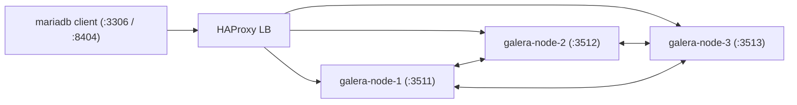

# Tutorial: MariaDB Galera Docker Lab

> **Learning Goal:** Start a 3-node MariaDB Galera Cluster with HAProxy locally and verify synchronous replication.
> **Environment Warning:** Run this lab only in an isolated Docker host. Never run lab commands against production clusters.

## Prerequisites

- Docker Engine and Docker Compose v2
- `mariadb` client (`make install-client` on Debian/Ubuntu)
- Free host ports `3306`, `3511`–`3513`, `8404`, `22001`, `24002`–`24003`

## Lab Architecture



## Step 1: Start the Galera Cluster

Move to `docker/mariadb` and launch the 3-node cluster with HAProxy:

```bash
cd docker/mariadb
make up-galera
```

Expected output confirms `Node 1 is Synced`, `Node 2 is Synced`, `Node 3 is Synced`, and `haproxy_galera` is running.

## Step 2: Check Cluster Status and Replication

Inspect Galera cluster variables and run the functional test suite:

```bash
make check-galera
make test-galera
make test-lb-galera
```

Expected output shows `WSREP_CLUSTER_SIZE=3`, `WSREP_LOCAL_STATE_COMMENT=Synced`, `WSREP_READY=ON`, and reports under `docker/mariadb/reports/`.

## Step 3: Tear Down the Lab

Stop containers and remove lab volumes when finished:

```bash
make clean-galera
```

## Next Steps

- Execute production runbooks: [How-To Guides](../02-how-to-guides/index.md)
- Look up targets and ports: [Reference](../03-reference/index.md)
- Review layered architecture: [Explanation](../04-explanation/index.md)
