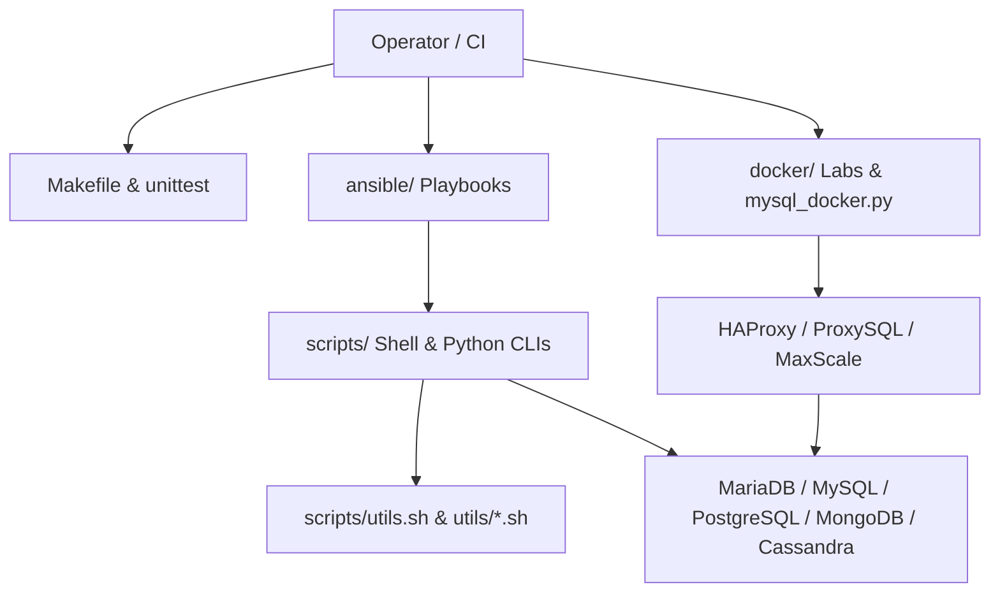

# Multi-DB Automation Architecture

`dbscripts` splits automation into four layers across hosts, Ansible, and Docker labs.

## System Topology

## Layers and Trade-Offs

- **Primitives (`scripts/utils.sh`, `utils/*.sh`)**: Logging, timers, DBMS wrappers.
- **Tasks (`scripts/*`, `scripts/bin/`)**: Tuning, Galera, backups, PITR, splitters.
- **Orchestration (`ansible/`)**: InnoDB Cluster, `run_script.yaml`, S3-to-RDS, Redis ACLs.
- **Labs & Tests (`docker/`, `tests/`)**: Compose labs and AST/YAML/`bash -n` tests.

| Choice | Advantage | Trade-Off |
|---|---|---|
| Bash + stdlib Python | Zero DB-host deps | Strict `set -euo pipefail` quoting |
| Offline AST/`bash -n` | 63 tests < 30s, no Docker | Failover tests need `docker/mariadb/` |
| Proxy tier | Decouples clients from failover | Extra ports (`9200`, `8404`, `6032`) |

[Scripts & CLI](../../03-reference/cli-and-scripts/scripts-and-cli-reference.md) | [Parameters & Ports](../../03-reference/configuration/automation-parameters-and-ports.md)
