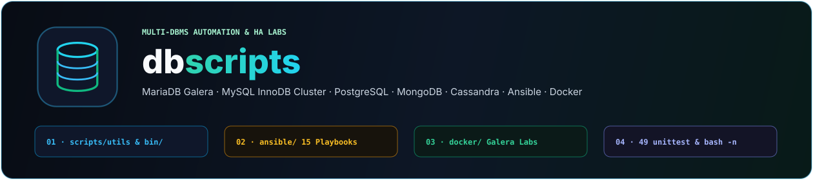

# Database Scripts Automation (`dbscripts`)

Automation for **MariaDB/Galera**, **MySQL**, **PostgreSQL**, **MongoDB**, **Cassandra**, and **Oracle**. Portal: [dbscripts.lightpath.fr](https://dbscripts.lightpath.fr/).

  
6 PlatformsMariaDB · MySQL · PG · Mongo · Cassandra · Oracle

  
15 PlaybooksInnoDB Cluster · S3-to-RDS · Redis ACLs

  
63 Unit Testsunittest · bash -n · YAML &amp; AST

  
4 QuadrantsDiátaxis · ASD-STE100 Issue 9

[Tutorials](01-tutorials/index.md){ .md-button .md-button--primary }
[How-To Guides](02-how-to-guides/index.md){ .md-button }
[Reference](03-reference/index.md){ .md-button }
[Explanation](04-explanation/index.md){ .md-button }

-   :material-school-outline:{ .lg .middle } **1. Tutorials** — Isolated Docker sandbox labs

    [Index](01-tutorials/index.md) · [Galera Lab](01-tutorials/01-mariadb-galera-docker-lab.md) · [MySQL CLI](01-tutorials/02-mysql-docker-cli-sandbox.md)

-   :material-wrench-outline:{ .lg .middle } **2. How-To Guides** — ASD-STE100 Issue 9 runbooks

    [Index](02-how-to-guides/index.md) · [Deploy Galera](02-how-to-guides/deployment/deploy-mariadb-galera-cluster.md) · [Backup & TLS](02-how-to-guides/operations/backup-restore-and-ssl-rotation.md) · [Quorum & PITR](02-how-to-guides/incident-response/recover-galera-quorum-and-pitr.md) · [Firewall & ACLs](02-how-to-guides/security/harden-firewall-tls-and-redis-acl.md)

-   :material-table-search:{ .lg .middle } **3. Reference** — CLIs, ports, and error matrix

    [Index](03-reference/index.md) · [CLI Reference](03-reference/cli-and-scripts/scripts-and-cli-reference.md) · [Params & Ports](03-reference/configuration/automation-parameters-and-ports.md) · [Alert Matrix](03-reference/troubleshooting-codes/database-alert-and-error-matrix.md)

-   :material-lightbulb-outline:{ .lg .middle } **4. Explanation** — Architecture and ADRs

    [Index](04-explanation/index.md) · [Architecture](04-explanation/architecture-overview/multi-db-automation-architecture.md) · [ADR-001](04-explanation/design-decisions/adr-001-diataxis-versioned-mkdocs-publishing.md)

-   :material-book-open-variant:{ .lg .middle } **Catalogs & Legacy Guides** — Module READMEs

    [Overview](../README.md) · [Ansible](../ansible/README.md) · [Docker Lab](../docker/mariadb/README.md) · [Guides](../documentation/README.md)

-   :material-history:{ .lg .middle } **Releases & Governance** — Registers

    [Changelog](../Changelog) · [Action Logbook](ACTION_LOGBOOK.md) · [RCA Register](RCA_REGISTER.md)

