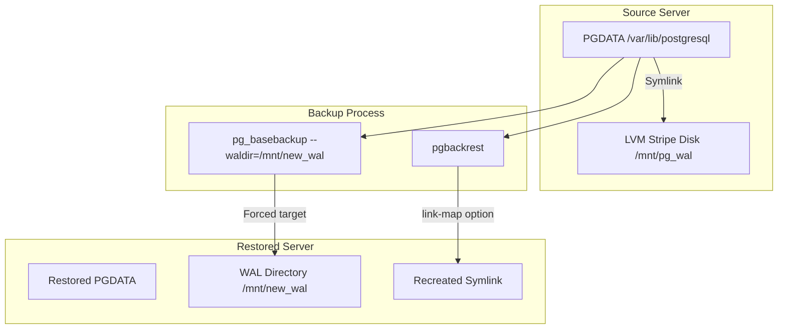

# PostgreSQL: Offloading the `pg_wal` Directory to a Dedicated Disk

Using `pg_basebackup` and `pgbackrest` when `pg_wal` is relocated via a symlink introduces distinct behaviors that you must understand to protect your Disaster Recovery strategy.

## I/O Optimization: LVM2 and Disk Striping

To maximize WAL write throughput, aggregating multiple physical disks with LVM2 distributes I/O load (IOPS) and increases bandwidth.

### 1. RAID 0 (Striping): Maximum Performance

Striping spreads data segments across multiple disks, parallelizing WAL writes at the hardware level.

- **Advantage**: Near-linear throughput scaling with the number of disks.
- **Risk**: **Zero redundancy**. Losing a single disk loses all WAL files, preventing crash recovery without a backup.
- **LVM Implementation**:

```bash
# Create a 3-disk striped logical volume (-i 3)
lvcreate -i 3 -I 64k -L 100G -n lv_postgres_wal vg_data /dev/sdb /dev/sdc /dev/sdd
```

### 2. RAID 10 (Striping + Mirroring): The Ideal Balance

RAID 10 combines RAID 0 speed with RAID 1 redundancy and requires at least 4 disks.

- **Advantage**: Strong read/write performance with fault tolerance (one failed disk per mirror).
- **Recommended Use**: Critical production workloads with high WAL write rates.
- **LVM Implementation**:

```bash
# Create a RAID 10 volume (2 stripes, each stripe mirrored)
lvcreate --type raid10 -i 2 -L 100G -n lv_postgres_wal vg_data
```

| Configuration | I/O Performance | Fault Tolerance | Minimum Disks |
| :--- | :--- | :--- | :--- |
| **Single Disk** | Standard | None | 1 |
| **LVM RAID 0** | **Maximum** | None (Risky) | 2 |
| **LVM RAID 10** | High | High | 4 |

## Backup Tool Behavior with Symlinks

Backup tools must handle files stored outside `PGDATA`. By default, a symlink points to an absolute path that may not exist on a backup or restore host.

### `pg_basebackup` Behavior

By default, `pg_basebackup` dereferences the symlink, copying WAL files into a physical `pg_wal` directory at the destination and losing the symlink.

**The `--waldir` Alternative (`-X stream --waldir=<absolute_path>`):** Forces the target WAL path during backup to rebuild a separate WAL layout.

- **Example Syntax**:

```bash
pg_basebackup -h localhost -D /var/lib/postgresql/backup/data \
  -Fp -X stream \
  --waldir=/mnt/dedicated_wal/pg_wal -P
```

- **Key Constraints**:
  - Supported only with **plain** format (`-Fp`).
  - The path must be **absolute**.
  - If the target directory exists, it must be **empty**.

#### Focus on `-n` (`--no-clean`)

By default, `pg_basebackup` deletes created directories after an error. Passing `--no-clean` changes this behavior:

**Advantages:**

- **Post-mortem Diagnostics**: Preserves data and WAL state at failure time for root-cause inspection (corruption, truncation, permissions).
- **Partial Recovery**: Retains transferred files for manual inspection or corrective `rsync`.

**Impacts and Risks:**

- **Orphaned Files**: Failed backups can leave gigabytes of data on disk and fill storage.
- **Blocked Retries**: Because `--waldir` requires an empty directory, the next backup run fails immediately until old files are removed.

### `pgbackrest` Behavior

`pgbackrest` handles symlinks natively:

- **During Backup**: Records the symlink target inside the backup manifest.
- **During Restore**: Provides `--link-all` and `--link-map` to recreate symlinks automatically.

## Feature Comparison Matrix

| Feature | `pg_basebackup` (default) | `pg_basebackup` (`--waldir`) | `pgbackrest` |
| :--- | :--- | :--- | :--- |
| **`pg_wal` Handling** | Dereferenced copy | Forced target path | Stores and recreates symlink |
| **Supported Formats** | Plain & Tar | **Plain only** | All formats |
| **Error Cleanup** | Automatic | Configurable (`--no-clean`) | Automatic (lock-managed) |
| **Automation** | Low | Medium | High |

## Backup and Restore Flow



## Security and Continuity Risks

- **Permissions**: The `postgres` OS user must own or have write access to the target WAL directory.
- **Disk Saturation**: With `--no-clean`, manual cleanup is mandatory after every failure before retrying.
- **Path Drift**: Changing mount paths (`/mnt/wal1` to `/mnt/wal2`) breaks restore scripts using hardcoded paths.
- **Hardware Reliability**: In RAID 0, adding more disks statistically increases overall volume failure probability.

**Sources and References**

1. [PostgreSQL Documentation: pg_basebackup (Options)](https://www.postgresql.org/docs/current/app-pgbasebackup.html)
2. [pgBackRest User Guide: Link Handling](https://pgbackrest.org/user-guide.html#concept/link-handling)
3. [LVM2 Resource: Striped Logical Volumes](https://access.redhat.com/documentation/en-us/red_hat_enterprise_linux/8/html/configuring_and_managing_logical_volumes/creating-a-striped-logical-volume_configuring-and-managing-logical-volumes)
